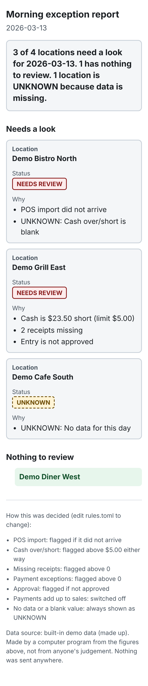

Start the morning knowing which locations need a look. Every day, a reviewer opens the daily sales summaries and hunts for what's wrong. This tool does that first pass for you. It reads the day's data and flags missing POS imports, cash over or short, missing receipts, payment exceptions and unapproved entries. You get a short report in plain English, readable on your phone.

- **Honest about gaps** (missing data is shown as UNKNOWN, never "all clean")
- **Yours to control** (the review rules are in one readable file you can edit)
- **Private by design** (runs on your own computer, your data never leaves it)
- **Optional local AI** (a plain-language summary sentence is available, and the report is fully correct without it)

Setup and support are available separately.

All rights reserved — Jay Rohrs.

This is an independent tool for Restaurant365 users. It is not made, endorsed or supported by Restaurant365. All restaurants, figures and names in this repository are made up demo data.

More pictures: [report on a desktop](docs/screenshots/demo-report-1366px.png), [settings on a phone](docs/screenshots/settings-390px.png), [settings on a desktop](docs/screenshots/settings-1366px.png), [view-then-email page on a phone](docs/screenshots/view-report-390px.png), [on a desktop](docs/screenshots/view-report-1366px.png).

## What is real and what is not yet proven

Please read this before relying on it.

| Part | Status |
|---|---|
| The checks, the report, UNKNOWN handling, HTML and email text, settings screen | Built and tested. |
| Connection to Restaurant365 | Built and tested **only against a pretend server**. It has **never been run against a real R365 tenant**. R365's documentation does not clearly say which data holds the daily sales summary, so the field names are not filled in: the checks show **"needs mapping"** until someone confirms them. See [docs/R365_OPEN_QUESTIONS.md](docs/R365_OPEN_QUESTIONS.md). |
| Approval check | **On by default** (it is the point of the tool). With R365 it shows "needs mapping" and does not run until an approval field is mapped, then it runs by itself. The demo and CSV examples include a "not approved" entry so you can see it work. |
| Email through Microsoft 365 | Built and tested only against a pretend Microsoft server. Not tried on a real account. |
| Windows installer, saved-password storage, automatic schedule | Written, **not yet run on a Windows computer**. |

## What it does not do

- It does not change anything in R365 or anywhere else. It only reads, and it only writes its own report files.
- It does not decide what is right. It applies the simple rules in `rules.toml` and shows its reasons.
- It does not fix problems, post entries, or contact anyone but you.
- It does not check that the figures themselves are correct, only whether they trip a rule or are missing.
- It is for Restaurant365 only.
- A check whose data it cannot get is **not run** and is listed in the report as "needs mapping". It never pretends everything is fine.

## Install on Windows (about 5 minutes)

1. Download this folder (green **Code** button, then **Download ZIP**) and unzip it.
2. Double-click **`install-windows.cmd`**. If Python is missing it installs it for you through Windows' own installer (winget). It needs no administrator rights.
3. Two shortcuts appear on your desktop and the settings screen opens:
   - **DSS Report Settings** - connect to R365, choose locations, set the rules, email and schedule.
   - **DSS Report Run Now** - makes yesterday's report and shows it on screen. You look it over first; nothing is emailed until you choose to.
4. To remove everything later, double-click **`uninstall-windows.cmd`**.

If Windows warns about an unknown publisher, that is because the file is not signed; read it first if you like, it is plain text.

## Try the demo (no R365 needed)

You need Python 3.11 or newer. In a terminal, in this folder:

`python -m dssreport run --input demo --out out/`

Open `out/report.html` in your browser (and `out/email.txt` for the plain-text email). The demo has 4 made-up restaurants and 14 days of data with planted problems. The default view is the latest day and already shows a location with no data and a blank cash figure as **UNKNOWN**. To see every planted problem:

`python -m dssreport run --input demo --out out/ --days 14`

## The settings screen

Open it with the desktop shortcut or `python -m dssreport settings`. It is a page in your browser that only your own computer can reach. Every setting has a one-line explanation:

- **Restaurant365:** connect, address, user name (Domain\Username), password.
- **Locations:** "only these locations" (optional), and a Show/Hide tick for each location the program has seen, so a closed restaurant can be switched off.
- **What counts as a problem:** a tick box and a number for each rule. They are saved into `rules.toml`, which you can still edit by hand.
- **Email:** prepare a draft after each scheduled run; who it goes to; your Microsoft app ID; **send automatically** (off by default - otherwise you only get a draft); sign in to Microsoft 365.
- **Schedule:** run automatically, time of day, days (weekdays by default). If the computer was off at that time, the report runs once when it next starts and is marked **late**.
- **Summary sentence (optional):** off by default.

### Connecting to R365

R365's address and your login come from R365 (their support enables the OData connector for your database). Enter them in settings and press **Save and test the connection**. The password is kept only in Windows Credential Manager, never in a file. Then the field mapping must be filled in once: run `python -m dssreport r365 discover` to list what your database offers, and put the names in `r365_mapping.toml` (a template is in `r365_mapping.example.toml`). Until then the report says "needs mapping" for every check it cannot do.

A restaurant that sends **no rows at all** is not listed, because the program does not guess which restaurants to expect. To be told when one goes quiet, add it under "Only these locations": it then shows as UNKNOWN. The report says this at the bottom.

Your real field mapping, R365 address and user name, Microsoft app ID and email address are typed into settings and kept in your own folder (`%LOCALAPPDATA%\DssReport`). They are never part of this repository.

### Look first, then email

"Run Now" (or the schedule) makes the report. The **view page** shows it on screen with two choices: **Create an email draft in Microsoft 365** (or send it, if "send automatically" is ticked - off by default, meant for administrators using their own accounts), or **Open in my mail app** (what a phone would use). Sign-in to Microsoft is on Microsoft's own page; this program never sees or stores your Microsoft password. The report page is attached to the Microsoft 365 draft and the text is in the body. Phone viewing away from the computer is a plan only: [docs/MOBILE_PLAN.md](docs/MOBILE_PLAN.md).

## Where your data stays

On your computer. The program makes network calls only to places you set up: your R365 address, Microsoft 365 if you turn email on, and a language model on this same computer if you turn that on. No analytics, no tracking, nothing else. Reports are saved in `%LOCALAPPDATA%\DssReport\reports` (and `out/` for demo runs, which git ignores). The R365 password and Microsoft sign-in live only in the operating system's credential store.

## Security

See [SECURITY.md](SECURITY.md). **Never commit real data to this repository.** The `.gitignore` blocks common data files, but keep real files outside the repository to be safe.

## For the person maintaining it

Tests: `python -m unittest` (no extra software). Design notes: [docs/DEVELOPER_NOTES.md](docs/DEVELOPER_NOTES.md). Plans, not built: [docs/LOCAL_MODEL_PLAN.md](docs/LOCAL_MODEL_PLAN.md), [docs/MOBILE_PLAN.md](docs/MOBILE_PLAN.md).
